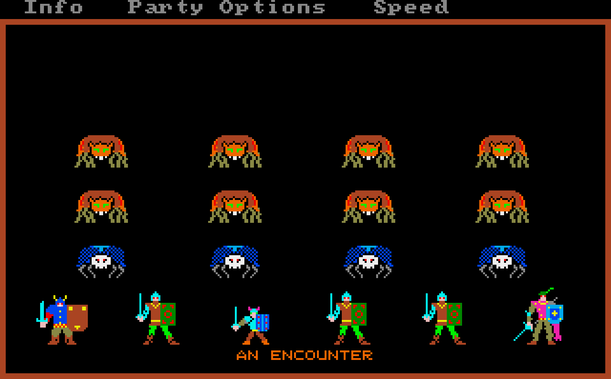
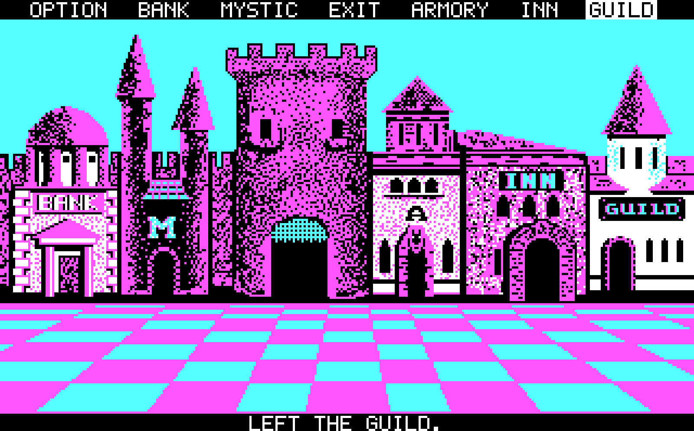
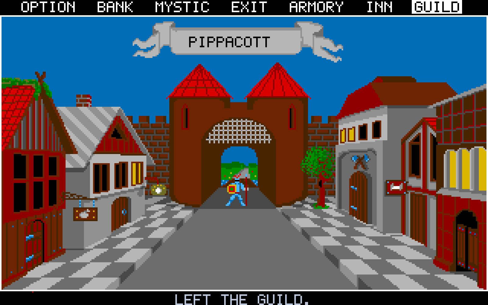
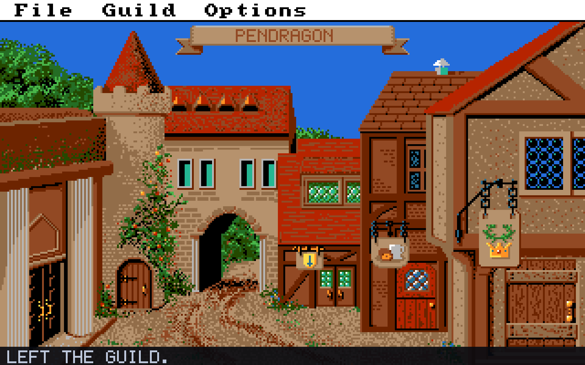
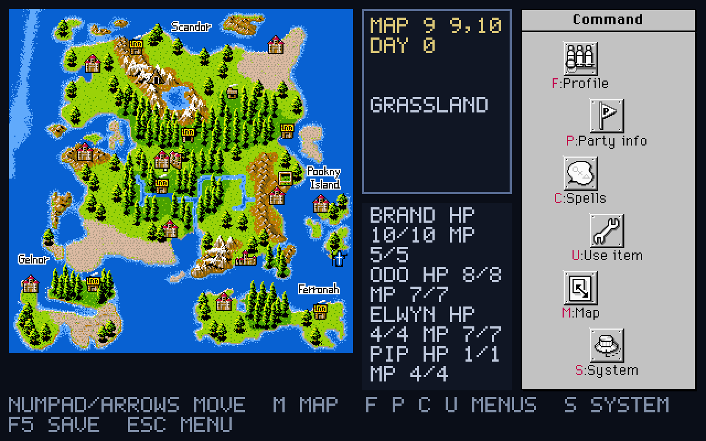

# OpenPhantasie

OpenPhantasie is a new engine for SSI's *Phantasie* series (Phantasie I, II and III, and the Japanese-only
Phantasie IV), written in C# with MonoGame. The four games run in one interface with one set of options. The rules
were reconstructed from the original programs and manuals, and the faithful behaviour stays the default; quality-of-life
changes are options you can switch on or off. Phantasie IV is played in English: a translation, keyed by the game's
own text ids, is laid over the Japanese text from your copy.

**This repository contains no game files.** No program, text, map, picture or music of the original games is in it.
To play, you need your own copy of each game you want to play. On first start, OpenPhantasie asks for your copy (disk
images, a zip, or the installed game's folder) and builds the game's tables, text, art and sound from it on your
machine.

For a common town interface across all four games, enable **UNIFIED TOWN MENU** in the game's new-game
Quality of Life options. It offers Town, Party, Magic and Game tabs with keyboard, mouse and gamepad navigation.
Unavailable services explain why; each campaign keeps its service rules. The choice is stored with the save.

## Screenshots

Each game is drawn with the pictures of the versions you imported. When you have more than one (Phantasie I's Amiga
and DOS pictures, for example), Options → the game's tab → GRAPHICS switches between them.

| | |
|---|---|
|  |  |
| **Phantasie I**, Amiga art: a fight | **Phantasie I**, DOS CGA art: the town |
|  |  |
| **Phantasie II**, Atari ST art: the town of Pippacott | **Phantasie III**, Amiga art: the town of Pendragon |



**Phantasie IV**, X68000 art: the world map, played in English

## Supported copies

| Game | Version | What it gives |
|---|---|---|
| Phantasie I | DOS, SSI 1987 or the WizardWorks Bonus Edition, including the Steam / GOG "Phantasie Memorial Set" (360K disk image or the game's folder) | the game (tables, text, maps) and the DOS CGA pictures |
| Phantasie I | Amiga v1.0, 1987 (`.adf`) | the Amiga pictures, title music and sounds (needs the DOS copy for the game itself) |
| | Amiga Kickstart 1.3 ROM | the Amiga screen font (optional, for the Amiga look) |
| Phantasie II | Atari ST v1.0 (two `.stx` or `.st` disks) | the game and the Atari ST pictures and music |
| Phantasie II | Apple II v1.0 (two-sided `.dsk` pair, including the Steam / GOG "Phantasie Memorial Set" disks) | the game and the Apple II pictures (a few values still differ from the Atari ST version and are under review) |
| Phantasie III | DOS, SSI 1988, WizardWorks 1991 or the "Phantasie Memorial Set" (disk image or folder) | the game and the DOS CGA pictures |
| Phantasie III | Amiga v1.0, 1987 (`.adf`) | the Amiga pictures, music and sounds (needs the DOS copy for the game itself) |
| Phantasie IV | X68000 Ver.1.02 (two `.dim` disks) | the game, its pictures, music and voices, with the English translation |

Copies are recognised by their content (checksums of the program and data files), not by file or folder names, so
an installed store version can be pointed at directly. A copy that has been played is imported as it is; the import
report says what that changes (for DOS Phantasie I: map regions already explored and fixed fights already won).
Other versions (C64, Apple II Phantasie I / III,
PC-88, PC-98, MSX2, …) are recognised but cannot be imported yet.

## Downloading and playing

Ready-to-run builds for **Windows**, **Linux** and **macOS** are on the
[Releases page](https://github.com/jjanow/OpenPhantasie/releases). Nothing else needs to be installed.

| System | File | To start |
|---|---|---|
| Windows (64-bit) | `OpenPhantasie-<version>-win-x64.zip` | unzip it and run `OpenPhantasie.exe` (Windows may warn about an unknown publisher: More info, Run anyway) |
| Linux (64-bit) | `OpenPhantasie-<version>-linux-x64.tar.gz` | unpack it (`tar xzf …`) and run `OpenPhantasie/OpenPhantasie` |
| macOS, Apple silicon | `OpenPhantasie-<version>-osx-arm64.tar.gz` | unpack it and open `OpenPhantasie.app` |
| macOS, Intel | `OpenPhantasie-<version>-osx-x64.tar.gz` | as above |

The macOS app is not notarised, so the first start is refused ("cannot be verified"). Either right-click the app and
choose Open, or run `xattr -dr com.apple.quarantine OpenPhantasie.app` once in Terminal.

Keep the game in a folder you can write to (your home folder, not Program Files or /Applications owned by another
user), so it can update itself.

### Updates

OpenPhantasie checks for a newer release each time it starts and offers to install it; the release notes show first
and nothing changes unless you choose UPDATE NOW. The check can be switched off in Options → General → CHECK UPDATES AT
START, and Options → General → UPDATE NOW checks at any time (it also shows the version you have). An update replaces
the program's folder and restarts the game; your settings, saves and imported games are in your user data folder (see
below) and are kept. The check asks GitHub's public releases page and sends nothing else.

Builds you make yourself (below) report version `0.0.0-dev` and never update themselves.

## Building and running

You need the [.NET 10 SDK](https://dotnet.microsoft.com/download).

```sh
dotnet build OpenPhantasie.sln
dotnet run --project src/OpenPhantasie.Client      # or ./play.sh
```

The first start shows the import screen: type or drop the paths of your copies (or pick a Steam / GOG library
shortcut) and import. Imports can be repeated or extended later from Options → General → Import games. A game with
nothing imported stays greyed out in the main menu.

The importer also runs on the command line:

```sh
dotnet run --project src/OpenPhantasie.Importer.Cli -- <path>... [--out DIR] [--list] [--steam]
```

`--list` only shows what was recognised; `--steam` adds the Steam / GOG library folders found on this machine.

Settings, saves and the import live in your user data folder: `~/.local/share/OpenPhantasie` on Linux,
`%LOCALAPPDATA%\OpenPhantasie` on Windows, `~/Library/Application Support/OpenPhantasie` on macOS (the import is in its
`import/` subfolder; delete that folder to start over).

## Making the downloads

`.github/workflows/build.yml` runs only for a release: pushing a tag `v1.2.3` runs the tests, builds the four downloads
and publishes them as release 1.2.3, with `docs/release-notes/v1.2.3.md` as its notes when that file exists. Ordinary
pushes run nothing; a manual run (Actions → Build → Run workflow) builds the downloads as artifacts without a release.
The same packaging runs locally:

```sh
python3 tools/scripts/package_release.py --rid linux-x64 --version 1.2.3 --out dist
```

(`--rid` is `win-x64`, `linux-x64`, `osx-x64` or `osx-arm64`; a macOS build is signed ad hoc only when made on a Mac.)

## Tests

```sh
dotnet test OpenPhantasie.sln
```

Tests that need the original games' data are skipped when it is not present, so the suite passes on a fresh clone.

## Layout

```
src/OpenPhantasie.Core/          rules: combat, magic, movement, towns, dungeons (no rendering)
src/OpenPhantasie.Data/          JSON schemas and loaders; GameData/ holds our own data (rules, numbers, layouts, text)
src/OpenPhantasie.Client/        the MonoGame front end
src/OpenPhantasie.Importer/      reads the player's copies (FAT12, AmigaDOS, Human68k, Apple RDOS, Pasti, zip) and builds the import
src/OpenPhantasie.Importer.Cli/  openphantasie-import, the command-line importer
tests/                           xUnit tests
tools/scripts/                   the Python reverse-engineering and extraction tools the importer was ported from
docs/plan/, reverse-engineering/ design notes and behavioural specs of the original programs
DIFFERENCES*.md                  every place where a game's manual and its program disagree, and what OpenPhantasie does
```

The files in `GameData/` that would hold a game's own text carry `...` where that text goes; the importer fills it in
from your copy (`strings/en.sources.json` says where each line is found).

## Contributions and bug reports

Contributions and bug reports are welcome! Please use
[GitHub Issues](https://github.com/jjanow/OpenPhantasie/issues) to report bugs or suggest improvements, and send
[pull requests](https://github.com/jjanow/OpenPhantasie/pulls) for code, documentation, translations or tests.
For a larger change, open an issue first so we can discuss the approach.

When reporting a bug, include your operating system, OpenPhantasie version, which game and source version you
imported, relevant options, steps to reproduce, and what you expected to happen compared with what happened.
Logs or screenshots can help. Please do not upload original game files, disk images, ROMs or manual scans.

To contribute code, follow the existing style and run `dotnet test OpenPhantasie.sln`. Keep game rules separate
from rendering, and make changes work across the supported games and languages where applicable.

## Licence

OpenPhantasie is released under the MIT licence (`LICENSE`). Third-party packages and their licences are listed in
`THIRD-PARTY-NOTICES.md` (MonoGame is under the MS-PL).

OpenPhantasie is an independent project. *Phantasie* and the original games belong to their respective owners.
